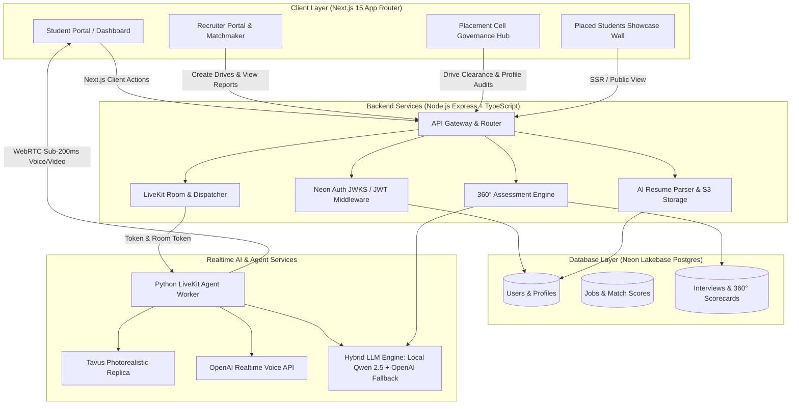

# 🎓 CampusHire AI (CampusOS)
### *Next-Gen, Privacy-Preserving AI Campus Recruitment, Placement Governance & 360° Candidate Verification Infrastructure*

[-black?style=flat&logo=next.js)](https://nextjs.org/)
[](https://livekit.io/)
[](https://tavus.io/)
[](https://neon.tech/)
[](https://github.com/QwenLM/Qwen2.5)
[](https://orm.drizzle.team/)
[](https://tailwindcss.com/)
[](https://opensource.org/licenses/MIT)

---

## 📌 Executive Summary

Every year, universities and visiting corporate recruiters face a massive bottleneck during campus placement drives:
1. **The Screening Bottleneck:** 5,000+ engineering students apply for campus drives simultaneously. HR recruitment panels spend 3+ weeks reviewing resumes and conducting repetitive first-round interviews.
2. **The Resume Inflation Crisis:** Students use generative AI to fabricate resumes, list unverified buzzwords, and exaggerate internship roles. Recruiters cannot tell who genuinely built their projects until costly late-stage interviews.
3. **The Data Privacy & Sovereign Cloud Dilemma:** Student academic records, transcripts, CGPAs, and video interview recordings represent sensitive institutional PII. Universities cannot leak unredacted student data to closed commercial clouds.

**CampusHire AI** solves this trifecta with an institutional, white-label placement infrastructure combining:
- 🛡️ **University Placement Cell "Drive Clearance" Governance:** An administrative verification gate where college officers clear student profiles and credentials before recruiters can match or interview them.
- 🎯 **Unified 360° Multi-Stage Assessment:** A 4-stage technical pipeline (Pre-Flight $\to$ Dynamic MCQs $\to$ Technical Architecture Scenarios $\to$ Live AI Video Avatar Interview $\to$ Synthesized Scorecard).
- 🕵️ **The AI Fact-Checking Cross-Examiner:** A LiveKit + Tavus AI recruiter that actively challenges verbal bluffing by cross-examining candidate claims against verified university profile records and Stage 1 MCQ misconceptions.
- 🔒 **Hybrid Sovereign LLM Architecture:** Local / On-Premise **Open-Source Qwen 2.5** inference for student PII privacy, backed by an auto-failover cloud pipeline (OpenAI `gpt-4o-mini`) for high-concurrency placement rush hours.
- 💼 **White-Label B2B Model:** Packaged as institutional infrastructure that universities license (e.g., *"Royal College PlacementOS"*) to accelerate placement conversion rates.

---

## 🏗️ System Architecture



---

## 🚀 Key Innovations & Core Features

### 1. 🛡️ University Placement Cell "Drive Clearance" Model
Unlike open job portals where candidates self-report arbitrary claims, CampusHire AI models the verified workflow of prestigious university placement offices:
- **Administrative Clearance:** College placement officers review student profiles, academic degrees, and CGPA records via the Placement Cell Dashboard (`/dashboard/placement-cell`).
- **Drive Clearance Status:**
  - `⏳ Pending Placement Cell Verification`: Students can practice mock AI interviews freely, but are withheld from recruiter matching to eliminate fraudulent claims.
  - `🛡️ Verified by Royal College Placement Cell`: Official verification unlock that makes the candidate visible to visiting corporate recruiters for AI matchmaking and drive invites.
  - `❌ Flagged / Revisions Required`: Placement cell can request proof of claimed internships or certifications before drive access is granted.
- **Dynamic Placed Students Wall:** Verified placement statistics, student profiles, hiring companies (Google, Microsoft, Razorpay, etc.), and CTC packages are showcased live on the platform homepage (`PlacedStudentsSection`).

---

### 2. 🎯 Unified 360° Assessment Pipeline
Every candidate undertakes a structured 4-stage evaluation generated dynamically from the specific job description:

```
┌──────────────────────────────────────────────────────────────────────────────────────────────────┐
│                                 THE 4-STAGE ASSESSMENT JOURNEY                                   │
└──────────────────────────────────────────────────────────────────────────────────────────────────┘

   [Stage 0]               [Stage 1]                 [Stage 2]               [Stage 3]
  PRE-FLIGHT              CORE MCQs             TECH ARCHITECTURE        LIVE AI AVATAR
• Placement Status Check• 4 Role MCQs         • 2 Real-world Scenarios • Sub-200ms WebRTC Call
• Honor Code Agreement  • Timed (5 mins)      • System Trade-offs      • Fact-Checking Agent
• Mic/Camera Preview    • Concurrency & DB    • Scalability & Debug    • Cross-Examination
        │                       │                         │                      │
        └───────────────────────┴─────────────────────────┴──────────────────────┘
                                                │
                                                ▼
                                    [Stage 4: THE 360° SCORECARD]
                          • Weighted Composite Score (25% MCQ / 35% Tech / 40% Voice)
                          • 🛡️ Authenticity & Integrity Audit (Exaggeration Detector)
                          • Actionable Recruiter Recommendation ("Strong Hire" / "Onsite")
```

- **Stage 0 (Pre-Flight Briefing):** Candidate clearance badge verification, job requirements review, honor code agreement, and microphone hardware check.
- **Stage 1 (Core MCQs):** 4 role-tailored questions testing foundational engineering concepts (e.g., concurrency locking, idempotency, B-Tree indexes, WebSocket protocols) with a live 5-minute countdown timer.
- **Stage 2 (Technical Architecture Scenarios):** Real-world applied engineering challenges where students explain their design trade-offs, edge-case mitigation, and failure recovery in written responses.
- **Stage 3 (Live Video AI Avatar Interview):** Sub-200ms WebRTC voice and video interview powered by our **LiveKit + Tavus replica** agent.
- **Stage 4 (360° Official Scorecard):** Synthesized evaluation report card with composite score breakdown, technical strengths, areas of improvement, and recruiter hiring verdict.

---

### 3. 🕵️ The AI Fact-Checking Cross-Examiner
Standard AI interview tools are passive and sycophantic—they smile and nod at whatever a candidate claims. CampusHire AI's Python agent (`agent.py`) acts as a perceptive **Technical Recruiter & Authenticity Investigator**:
- **Candidate Dossier Injection:** When generating the LiveKit dispatch token, the backend injects the candidate's verified college profile, Stage 1 MCQ mistakes, and Stage 2 technical submissions into room metadata.
- **Adaptive Stage 1 Follow-Up Probes:**
  > *"Welcome Mohamed! I noticed you scored 75% on the MCQs, but selected HTTP long-polling over WebSockets in question 4. What led you to favor polling there, and how would that impact your server overhead?"*
- **Anti-Exaggeration Cross-Examination:**
  - If a student makes an unverified claim (*"I worked at Google and single-handedly scaled their distributed search engine"*):
  - The AI counters firmly and politely:
  > *"That sounds fascinating. However, I have your verified profile from KTU University right in front of me, which lists an academic portal project and an internship. Could you clarify where this Google work took place and what was your exact individual role?"*

---

### 4. 🔒 Data Privacy & Hybrid Sovereign LLM Architecture
Student transcripts, CGPAs, and interview audio/video recordings represent sensitive institutional PII that cannot be leaked to closed commercial clouds.
- **Primary Sovereign Engine:** Local / Private on-prem inference using **Alibaba Qwen 2.5 (7B/14B/72B)** or DeepSeek. Student data stays strictly within the institutional perimeter.
- **High-Availability Cloud Fallback:** Automatic failover to OpenAI (`gpt-4o-mini` / `gpt-4o`) during massive 10,000-student placement rush hours, guaranteeing 99.99% uptime with zero queue timeouts.
- **Zero Third-Party Training:** No institutional candidate data or transcripts are retained for external model training.

---

### 5. 🎨 Design Aesthetics: Hand-Drawn Notebook Theme
The UI uses a custom **hand-drawn notebook theme** that is tactile, friendly, and gamified to reduce interview anxiety while maintaining professional rigor:
- **Borders:** Crisp retro borders (`border-2 border-black` / `border-4 border-black`).
- **Shadows:** Hard box shadows (`shadow-[4px_4px_0px_0px_rgba(0,0,0,1)]`).
- **Typography:** Google Font **Kalam** (`font-kalam`) for headings, badges, and accents.
- **Backgrounds:** Global graph-paper grid pattern.
- **Color Accents:** Curated notebook palette (`#fcec6a` yellow, `#7cb4cf` blue, `#e15b58` red, `#dcfce7` green).

---

## 🛠️ Complete Tech Stack

| Domain | Technology | Version | Purpose |
| :--- | :--- | :--- | :--- |
| **Frontend Framework** | **Next.js** | `15.x / 16.x (React 19)` | App Router, SSR, Turbopack, and Client assessment wizard |
| **Styling** | **Tailwind CSS** | `v4.x` | Custom notebook design system, Kalam typography, retro borders |
| **UI Components** | **shadcn/ui + Lucide** | Latest | Accessible badges, buttons, dialogs, progress bars, cards |
| **Realtime WebRTC** | **LiveKit Cloud** | `v2.x SDK` | Low-latency audio streaming & agent dispatch orchestration |
| **Video Avatar** | **Tavus Replica** | Latest | Photorealistic lip-synced visual recruiter avatar |
| **Voice AI Engine** | **OpenAI Realtime API** | Latest | Low-latency conversational voice agent streaming |
| **Backend API** | **Node.js + Express** | `Express 4.19 / Node 20` | TypeScript microservices handling assessment, matching, auth |
| **Database** | **Neon Lakebase Postgres** | Serverless | Serverless PostgreSQL with schema branching and connection pooling |
| **Database ORM** | **Drizzle ORM** | `0.45.x` | Type-safe SQL migrations and relational schema queries |
| **Authentication** | **Neon Auth** | `@neondatabase/auth` | Asymmetric JWKS / JWT cryptographic token verification |
| **Resume Parser** | **pdf-parse + OpenAI** | `1.1.1` | Automated PDF text extraction and structured JSON resume filling |
| **Email Delivery** | **Resend API** | `v6.x` | Transactional invitation links for matched candidate drives |
| **Hybrid LLM** | **Alibaba Qwen 2.5 + OpenAI** | `7B / 14B / gpt-4o-mini` | On-premise private sovereign inference with cloud failover |

---

## 📂 Project Directory Structure

```
recruitment_platform/
├── app/                                    # Next.js App Router
│   ├── dashboard/
│   │   ├── student/                        # Student Portal
│   │   │   ├── interview/[id]/             # 4-Stage 360° Assessment Wizard
│   │   │   ├── jobs/                       # Available Job Drives & Clearance Status
│   │   │   └── profile/                    # AI Resume Parser & Profile Manager
│   │   ├── recruiter/                      # Recruiter Portal
│   │   │   ├── page.tsx                    # Recruiter Metrics & Candidate Submissions
│   │   │   └── jobs/                       # Job Posting Engine & Matchmaker
│   │   └── placement-cell/                 # Placement Cell Governance Hub
│   │       └── page.tsx                    # Student Verification Queue & Drive Clearance
│   ├── login/ & register/                  # Neon Auth Authentication Pages
│   ├── globals.css                         # Graph-paper background & Notebook styles
│   ├── layout.tsx                          # Root Layout with Font & Meta tags
│   └── page.tsx                            # Homepage with Placed Students Showcase Wall
├── backend/                                # Node.js + Python Backend Services
│   ├── agent.py                            # Python LiveKit Worker (Realtime AI + Tavus)
│   ├── requirements.txt                    # Python dependencies (livekit-agents, etc.)
│   ├── src/
│   │   ├── db/
│   │   │   ├── index.ts                    # Neon Postgres Connection Pool
│   │   │   └── schema.ts                   # Drizzle Database Schema (Users, Jobs, Interviews)
│   │   ├── middleware/
│   │   │   └── auth.ts                     # Neon Auth JWKS & optionalAuth Middleware
│   │   ├── routes/
│   │   │   ├── interviews.ts               # 360° Assessment, Dynamic Questions & Scorecard
│   │   │   ├── placement-cell.ts           # Drive Clearance & Student Verification APIs
│   │   │   ├── recruiter-dashboard.ts      # Recruiter Stats & Candidate Ranking
│   │   │   ├── match.ts                    # AI Matchmaking Engine (Student <-> Job)
│   │   │   └── resume.ts                   # PDF Extraction & AI Schema Parser
│   │   └── index.ts                        # Express Server & LiveKit Token Dispatcher
│   └── package.json                        # Backend Scripts & Dependencies
├── components/                             # Reusable UI Components
│   ├── home/
│   │   └── placed-students-section.tsx     # Placed Students Showcase Ticker & Wall
│   ├── layout/
│   │   ├── app-sidebar.tsx                 # Navigation Sidebar with Role Filters
│   │   ├── navbar.tsx                      # Header Navbar & User Controls
│   │   └── role-guard.tsx                  # Client-side Safe Role Routing (Prevents Dropped Segments)
│   └── ui/                                 # Button, Card, Badge, Dialog, Progress primitives
├── public/                                 # Static Assets & Icons
├── package.json                            # Root Next.js Dependencies & Scripts
├── AGENTS.md                               # Agent Architecture & Styling Rules
└── README.md                               # Master Project Documentation
```

---

## 📡 Complete REST API Reference

### 1. Authentication & Profile
| Method | Endpoint | Auth | Description |
| :--- | :--- | :--- | :--- |
| `GET` | `/health` | Public | Healthcheck verification endpoint |
| `GET` | `/api/me` | JWT | Get current authenticated user record from Postgres |
| `POST` | `/api/users` | JWT | Sync newly registered user into the database |
| `PUT` | `/api/users/profile` | JWT | Update student profile (auto-resets status to `pending`) |

### 2. University Placement Cell Governance
| Method | Endpoint | Auth | Description |
| :--- | :--- | :--- | :--- |
| `GET` | `/api/placement-cell/stats` | JWT | Get total, pending, verified, and rejected student counts |
| `GET` | `/api/placement-cell/students` | JWT | List student profiles with status filter and search query |
| `POST` | `/api/placement-cell/students/:id/verify` | JWT | Grant official **Drive Clearance** to a student |
| `POST` | `/api/placement-cell/students/:id/reject` | JWT | Flag profile and request revision with feedback |
| `POST` | `/api/placement-cell/students/:id/reset-pending` | JWT | Reset student verification status to pending |

### 3. Jobs & AI Matchmaking
| Method | Endpoint | Auth | Description |
| :--- | :--- | :--- | :--- |
| `POST` | `/api/jobs` | JWT | Post a new job drive (recruiter only) |
| `GET` | `/api/jobs` | JWT | List jobs created by the logged-in recruiter |
| `GET` | `/api/jobs/all` | JWT | List all active job drives for student browsing |
| `POST` | `/api/jobs/match` | JWT | Compute cosine semantic match between student profile & job |

### 4. 360° Assessment & Interview Pipeline
| Method | Endpoint | Auth | Description |
| :--- | :--- | :--- | :--- |
| `GET` | `/api/interviews/session/:id` | Optional | Fetch interview session state & dynamically generate MCQs |
| `POST` | `/api/interviews/session/:id/submit-stage` | Optional | Submit Stage 1 MCQs or Stage 2 Technical solutions |
| `POST` | `/api/interview/token` | JWT | Generate LiveKit token with student dossier metadata |
| `POST` | `/api/interviews/complete` | Optional | Synthesize 360° Scorecard with Authenticity & Integrity Audit |

### 5. Resume & Document Parsing
| Method | Endpoint | Auth | Description |
| :--- | :--- | :--- | :--- |
| `POST` | `/api/resume/parse` | Public | Upload PDF resume, extract text, and auto-parse via OpenAI |

---

## ⚡ Getting Started & Local Development

### 1. Prerequisites
- **Node.js** v20+ (Node 18.18+ supported)
- **Python** 3.10+ (with `venv`)
- Active **LiveKit Cloud** account & API Keys
- Active **Neon PostgreSQL** database
- Active **OpenAI** API Key (for Realtime Voice, LLM generation, or fallback)
- *(Optional)* **Tavus** API Key & Replica ID for visual avatar streaming

---

### 2. Environment Configuration

#### Frontend (`.env.local` in root directory):
```env
NEXT_PUBLIC_BACKEND_URL=http://localhost:8000
NEXT_PUBLIC_LIVEKIT_URL=wss://<YOUR_LIVEKIT_PROJECT>.livekit.cloud
```

#### Backend (`backend/.env` in `backend/` directory):
```env
PORT=8000

# Neon Postgres Database
DATABASE_URL=postgresql://<USER>:<PASSWORD>@<NEON_HOST>/neondb?sslmode=require

# Neon Auth Configuration
NEON_AUTH_BASE_URL=https://<NEON_AUTH_ID>.neon.tech/neondb/auth
NEON_AUTH_JWKS_URL=https://<NEON_AUTH_ID>.neon.tech/neondb/auth/.well-known/jwks.json

# LiveKit WebRTC Configuration
LIVEKIT_URL=wss://<YOUR_LIVEKIT_PROJECT>.livekit.cloud
LIVEKIT_API_KEY=<YOUR_LIVEKIT_API_KEY>
LIVEKIT_API_SECRET=<YOUR_LIVEKIT_API_SECRET>

# AI Engines & Models
OPENAI_API_KEY=sk-proj-...
# Optional Sovereign Qwen Local Endpoint
# QWEN_ENDPOINT_URL=http://localhost:11434/v1

# Tavus Replica Video Avatar
TAVUS_API_KEY=<YOUR_TAVUS_API_KEY>
TAVUS_REPLICA_ID=<YOUR_REPLICA_ID>

# Transactional Invites
RESEND_API_KEY=re_...
```

---

### 3. Step-by-Step Installation

#### Step 1: Install Frontend Dependencies
```bash
# In the root repository directory:
npm install
```

#### Step 2: Install Backend Dependencies
```bash
# In the backend directory:
cd backend
npm install
```

#### Step 3: Setup Python Virtual Environment for LiveKit Agent
```bash
# In backend/ directory:
python -m venv venv

# Windows:
.\venv\Scripts\pip install -r requirements.txt

# Linux / macOS:
source venv/bin/activate
pip install -r requirements.txt
```

#### Step 4: Run Database Migrations (Neon Postgres)
```bash
# Inside backend/ directory:
npm run db:push
```

---

### 4. Running the Platform

To run the complete platform, start both the **Frontend** and **Backend Services**:

#### Terminal 1 — Frontend (Next.js 15):
```bash
# In root directory:
npm run dev
# Next.js will launch on http://localhost:3000
```

#### Terminal 2 — Backend Services (Express API + Python LiveKit Agent):
```bash
# In backend directory:
npm start
# Concurrently runs Express on port 8000 and the Python LiveKit Agent worker
```

> **Tip (Standalone Agent Run):** To run or debug the LiveKit Python agent independently with verbose logging:
> ```bash
> cd backend
> .\venv\Scripts\python.exe agent.py dev
> ```

---

## 🧪 Testing the Complete End-to-End User Journey

1. **Register as a Student:**
   - Navigate to [http://localhost:3000/register](http://localhost:3000/register).
   - Sign up with role **Student** (`Mohamed Amaan`).
   - Go to `/dashboard/student/profile` and upload a PDF resume to auto-fill your skills, projects, and internships.
2. **Placement Cell Clearance Gate:**
   - Log into a Placement Officer account (or use `/dashboard/placement-cell`).
   - Notice the student's badge: `⏳ Pending Placement Cell Verification`.
   - Click **"Approve & Grant Drive Clearance"** to verify the candidate (`🛡️ Verified by Royal College Placement Cell`).
3. **Launch the 360° Assessment:**
   - As the student, visit `/dashboard/student/jobs` and click **"Start Assessment"** on any drive.
   - **Stage 0 (Pre-Flight):** Verify your placement clearance badge and accept the honor code.
   - **Stage 1 (Core MCQs):** Complete the 4 role questions before the 5-minute timer expires.
   - **Stage 2 (Technical Scenarios):** Write architectural solutions explaining trade-offs.
   - **Stage 3 (Live Video Avatar):** Join the LiveKit room. The Tavus avatar will greet you, probe your Stage 1 MCQ mistakes, and challenge any unverified project claims!
   - **Stage 4 (Official Scorecard):** Click **"End Call & Generate 360° Report"** to view your comprehensive evaluation with weighted score and Authenticity Audit!

---

## ❓ Troubleshooting & FAQs

- **Avatar not appearing in Stage 3?**
  - Ensure `npm start` in `backend` is running, or verify the Python worker is active via `.\venv\Scripts\python.exe agent.py dev`. If no Tavus key is supplied, the agent gracefully runs in high-fidelity audio mode.
- **Dropped segment warning during role transitions?**
  - `<RoleGuard>` uses CSS visibility toggling (`display: none`) and `<Suspense>` boundaries to preserve the Next.js 15 tree without unmounting segment roots.
- **Database connection timeouts?**
  - Neon Postgres auto-scales to zero when idle. The connection string includes pooling (`?sslmode=require`) to handle instant wake-ups automatically.

---

## 🏆 Hackathon Pitch Deck & Architecture Deep-Dive

For a slide-by-slide investor & hackathon presentation covering the market sizing, B2B university revenue model, unit economics, and technical moat, view the companion artifact:
📄 [**Hackathon Pitch Deck**](file:///C:/Users/amaan/.gemini/antigravity-ide/brain/61b722c4-eb81-473f-8647-f245145382ce/hackathon_pitch_deck.md)

---

## 👥 Authors & Team

Developed with ❤️ for the Hackathon by:
- **Mohamed Amaan** — *Full-Stack Architecture, AI Agent Systems & WebRTC Orchestration*
- Open to university pilot deployments, educational institution partnerships, and research collaborations!

---

## 📜 License

This project is licensed under the **MIT License**. See the [LICENSE](LICENSE) file for details.
